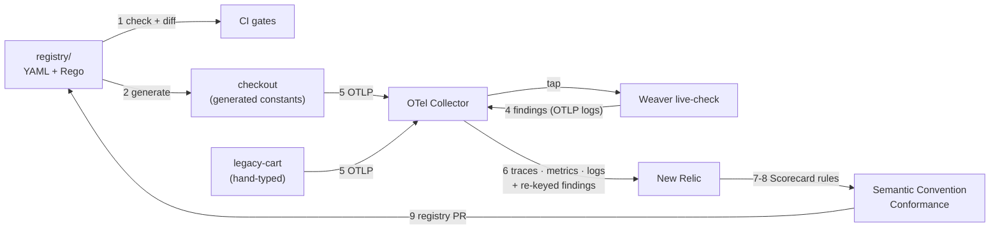

# Semantic convention governance: OpenTelemetry Weaver + New Relic Scorecards

**Standardize left, verify right.** This repo is the runnable companion to the
*Semantic Convention Governance with OpenTelemetry Weaver and New Relic Scorecards*
reference architecture. It shows a telemetry contract (a Weaver registry) enforced at
build time, checked against live traffic, and graded per service in New Relic.

Two services run side by side:

| Service | What it represents |
| --- | --- |
| `checkout` | Adopted the registry. Uses Weaver-generated constants, stable HTTP conventions, and declares the registry version it was built against. |
| `legacy-cart` | Instrumented with the same OpenTelemetry SDK but never adopted the registry: hand-typed attribute names, pre-stable HTTP attributes, an email address in a log, no version or owner. |

Weaver's CI checks never see `legacy-cart`, so its build stays green. Live-check and
the Scorecard both catch it. That gap is the whole argument for doing both.



## What's in here

```
registry/                     The contract: manifest (pins OTel semconv v1.42.0), Acme attributes, signals, event
policies/registry/acme.rego   House rules for `weaver registry check`
policies/live_check/          Live-check advisors: Weaver's default OTel advice (vendored) + PII-in-values check
templates/registry/python/    Weaver codegen templates -> services/checkout/acme_semconv/
.weaver.toml                  Live-check config: finding filters and level overrides
services/                     checkout, legacy_cart, shared OTel bootstrap, stdlib load generator
collector/config.yaml         Fan-out to New Relic + live-check; re-keys findings to the source service
docker-compose.yaml           Everything above, one command
scorecard/                    Scorecard spec, one NRQL file per rule, Terraform config (terraform/), verify queries
.github/workflows/            CI gates: registry check/diff/codegen drift, live-check on checkout
```

## Prerequisites

- Docker with Compose v2.
- A New Relic account and an **ingest license key**.
- For the Scorecard: a **User API key** with permission to modify Scorecards (Organization Product
  Admin or a custom Scorecards role) and Terraform 1.3+.
- Optional, to run the CI gates locally: [Weaver v0.28.0](https://github.com/open-telemetry/weaver/releases).

## Quick start

```bash
cp .env.example .env          # set NEW_RELIC_LICENSE_KEY (and the EU endpoint if needed)
docker compose up --build -d  # checkout, legacy-cart, loadgen, collector, weaver
docker compose logs -f collector   # Weaver findings print here via the debug exporter
```

Data appears in New Relic within a minute or two. Run the queries in
[`scorecard/verify.nrql`](scorecard/verify.nrql) to confirm both services report traces, metrics,
and logs, and that findings are attached to `legacy-cart`, not to a service called `weaver`.

Then create the Scorecard:

```bash
# In .env: NEW_RELIC_USER_API_KEY=NRAK-... and NEW_RELIC_ACCOUNT_ID=1234567
make scorecard-plan    # review the plan
make scorecard-apply   # create it; re-run after editing scorecard/ to update in place
```

Scorecard rules run at most hourly, so the first results appear within the hour.

## Walkthrough (matches the reference architecture's workflow steps)

**1. Check and diff the registry.** `make check` runs `weaver registry check` with
`policies/registry/acme.rego`: Acme attributes must use the `acme.` namespace and have a brief,
names must not suggest PII, stable signals may only reference stable attributes, and metrics should
declare a unit. `make diff BASELINE=<vdir>` shows what changed against the last release; the CI
workflow posts that diff to the pull request summary.

**2. Generate constants.** `make generate` renders `templates/registry/python/` into
`services/checkout/acme_semconv/`. The checkout service imports `attrs.ACME_ORDER_ID` instead of
typing `"acme.order.id"`, so a typo fails at import time. `make check-generated` fails CI if someone
edits the registry without regenerating.

**3. Live-check in CI.** `.github/workflows/telemetry-contract.yml` starts a live-check session,
runs the checkout service, drives traffic with `loadgen.py --once`, and stops the session with
`fail-on: none`. Start warn-only; flip to `violation` once the baseline is clean.

**4. Findings become telemetry.** In Compose, live-check runs continuously and emits every finding
as an OTLP log (`event: weaver.live_check.finding`) to a separate Collector receiver. A finding's
resource says `service.name=weaver`; the source service is in the log attribute
`weaver.finding.resource.attribute.service.name`. The Collector's `groupbyattrs` + `transform`
processors promote it to `service.name`, so New Relic correlates each finding with the right service.

**5-6. Export.** Application traces, metrics, and logs go to New Relic over OTLP/HTTP (delta
temporality), and a copy goes to live-check. Findings go only to New Relic, so no loop is possible.

**7-8. Score.** Five NRQL rules, weighted and grouped into maturity levels:

| Level | Rule | Reads | Expected: checkout | Expected: legacy-cart |
| --- | --- | --- | --- | --- |
| Basic (5) | Resource identity | `Span` | pass | fail: no `service.version`, `acme.team`; deprecated `deployment.environment` |
| Basic (5) | Registry adoption | `Span` | pass | fail: no `acme.schema_url` |
| Intermediate (3) | Stable HTTP conventions | `Span` | pass | fail: `http.method`, `http.target`, `http.status_code` |
| Intermediate (3) | Live-check clean | `Span, Log` | pass | fail: violations below |
| Advanced (1) | Registry-only attributes | `Span, Log` | pass | fail: `missing_attribute` |

Expected maturity: **checkout = Advanced**, **legacy-cart = Below basic**. Note that rule 3 needs no
Weaver at all. New Relic sees that drift directly, which is why the "verify right" half is valuable
even before every team adopts the registry.

**9. Close the loop.** Failing rules and `missing_attribute` findings tell the platform team what to
fix in services, or what to add to the registry by pull request.

### Expected live-check findings for legacy-cart

| Finding | Level | Caused by |
| --- | --- | --- |
| `missing_attribute` | violation | `order_id`, `itemCount`, `channel`, `customer_email`, `deployment.environment`, and the pre-stable `http.*` / `net.*` attributes |
| `missing_metric` | violation | `cartTotal`, `http.server.duration` (the pre-stable HTTP metric) |
| `invalid_format` | violation | `itemCount` (attribute) and `cartTotal` (metric) are not lower snake case |
| `acme_pii_value` | violation | an email address in the `customer_email` log attribute |
| `missing_namespace` | improvement | `order_id`, `itemCount`, `channel`, `customer_email` |

The checkout service should produce no violations. Development-stability Acme attributes are
filtered out of `not_stable` advice in `.weaver.toml`.

## Design notes and gotchas

- **`--advice-policies` replaces Weaver's default advice.** `policies/live_check/otel_default.rego`
  is vendored from Weaver v0.28.0 so the default naming checks keep running next to the PII check.
  Re-copy it when you upgrade Weaver.
- **Reference what you emit.** Weaver only includes upstream attributes your registry references
  (`--include-unreferenced` defaults to false). Anything a service legitimately emits from upstream
  conventions must appear in an `acme.refs.*` group, or live-check reports `missing_attribute`.
- **Python HTTP instrumentation still defaults to pre-stable names.** Set
  `OTEL_SEMCONV_STABILITY_OPT_IN=http` (or `http/dup` while migrating dashboards).
- **The SDK `LoggingHandler` is deprecated** (since opentelemetry-sdk 1.40). This demo uses
  `opentelemetry-instrumentation-logging`, which also promotes `extra={"otel.event.name": ...}` to the
  log record's EventName, so live-check can match the `acme.order.placed` event definition.
- **The registry version travels as a resource attribute.** OTLP has a `schema_url` field, but New
  Relic doesn't document keeping it and the Collector's OTTL can't read it. The checkout service sets
  `acme.schema_url` from the generated `SCHEMA_URL` constant.
- **Absence isn't a pass.** A clean service emits no findings. Rules 4 and 5 query `FROM Span, Log`
  so every reporting service gets a row and scores 1, instead of disappearing as "not evaluated".
- **Sample the live-check tap.** `probabilistic_sampler/weaver` is set to 100% for a fast demo. In
  a real staging environment, send live-check a slice.
- **Pinned versions:** Weaver v0.28.0, semantic conventions v1.42.0, Collector contrib 0.164.0,
  OpenTelemetry Python 1.45 / 0.66b. Bump deliberately; `make diff` shows the impact.

## Troubleshooting

| Symptom | Check |
| --- | --- |
| No data in New Relic | `docker compose logs collector` for 401/403 (license key) or 404 (endpoint). |
| Findings attached to `weaver` | The re-key processors in `collector/config.yaml`; query 3 in `verify.nrql`. |
| Rules 4-5 show "not evaluated" for a service | Query 4 in `verify.nrql`: findings need `entity.guid`. |
| Weaver container exits on start | It downloads semconv v1.42.0 from GitHub on startup; check outbound access. |
| `missing_attribute` on checkout | Something new is emitted; add a `ref` to an `acme.refs.*` group and `make generate`. |

## Cleaning up

```bash
docker compose down
```

Run `terraform destroy` in `scorecard/terraform` (with the same env as `make scorecard-apply`).

<!-- Screenshot placeholders for the blog:
  [1] docker compose logs: a weaver.live_check.finding LogRecord for legacy-cart
  [2] New Relic Logs: findings faceted by service.name and weaver.finding.id
  [3] Scorecard rule view grouped by maturity level
  [4] Scorecard entity view: checkout Advanced, legacy-cart Below basic
-->
